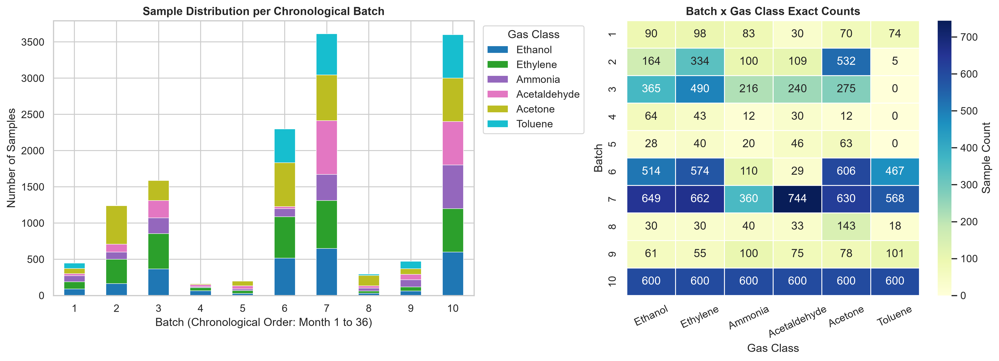
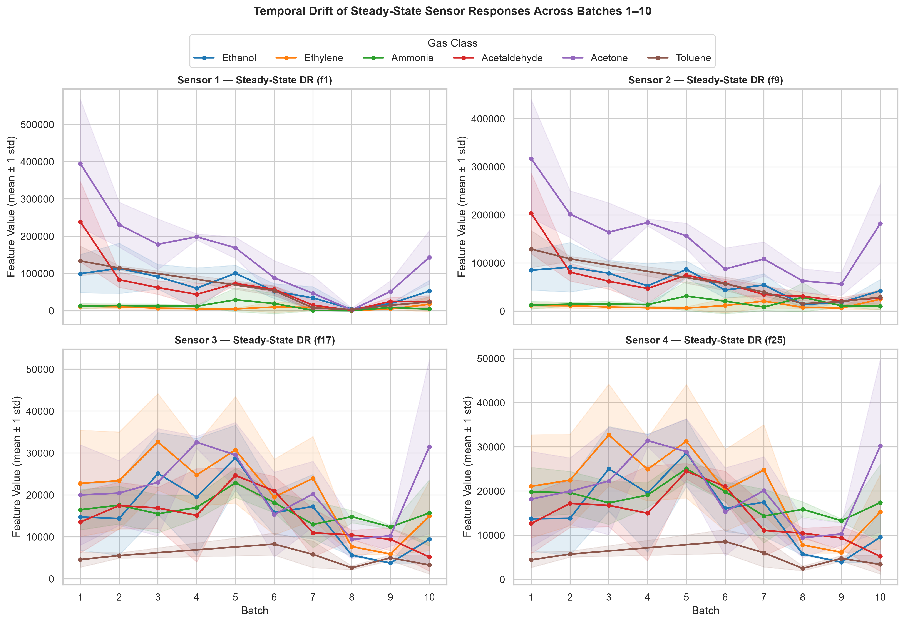
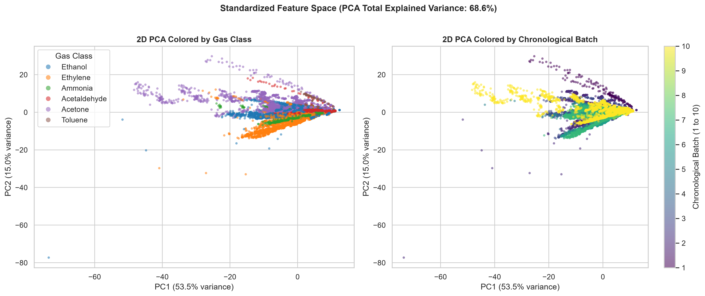
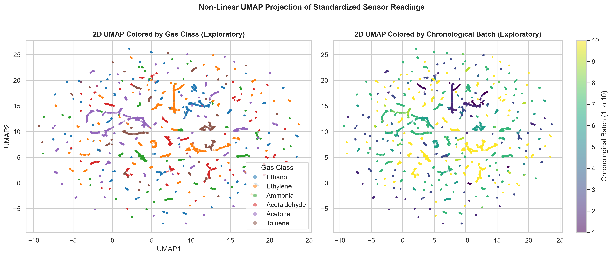
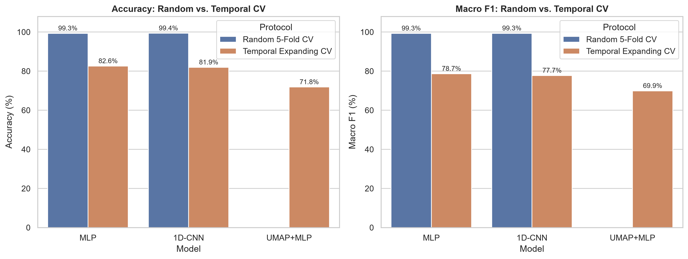
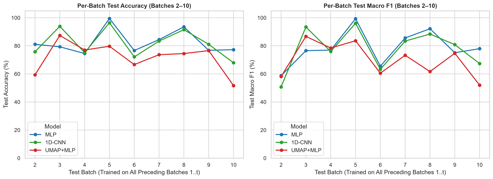
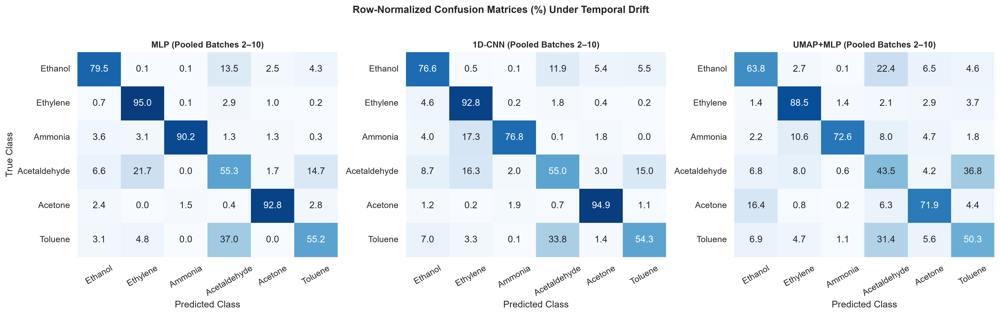

# Deep Learning for Multi-Class Gas Classification Under Temporal Sensor Array Drift

**Project 2.6 — Gas Sensor Array Drift**  
*Course Project Technical Report*

> **Reproducibility & Source Code:** Complete experimental source code, computational notebooks, and reproduction instructions are publicly available on GitHub: https://github.com/z64x/Deeplearn-project (notebooks: `notebooks/01_eda_gas_sensor_drift.ipynb` and `notebooks/02_experiments_mlp_cnn_umap.ipynb`; modules: `src/data_loader.py`, `src/models.py`, `src/train_eval.py`).

---

## 1. Introduction

Electronic nose (e-nose) systems built from Metal-Oxide (MOX) chemical sensor arrays are widely used in environmental monitoring, industrial safety, food quality control, and medical diagnostics to identify volatile organic compounds and toxic gases [1]. Unlike single-purpose analytical instruments such as gas chromatographs, MOX sensor arrays provide compact, low-cost, real-time sensing by combining multiple cross-sensitive elements whose electrical conductance changes upon exposure to target analytes.

Despite their practical appeal, MOX sensor arrays suffer from a well-documented degradation phenomenon known as **sensor drift** [1, 2]. Sensor drift refers to gradual, non-deterministic shifts in sensor baseline responses and sensitivity over weeks or months of operation caused by sensor poisoning, aging, thermal cycling, surface contamination, and ambient humidity or temperature fluctuations [2, 3]. From a machine learning perspective, drift induces **covariate shift** ($P_{\text{train}}(X) \neq P_{\text{test}}(X)$) and **concept drift**, causing classifiers trained on historical calibration data to degrade severely when deployed on future measurements.

Traditional shallow classifiers (such as Support Vector Machines or $k$-Nearest Neighbors) rely heavily on explicit drift-correction preprocessing or frequent recalibration [1, 4]. Deep Learning (DL) models—particularly Multi-Layer Perceptrons (MLPs) equipped with Batch Normalization [5], Dropout regularization [6], and weight decay, as well as 1D Convolutional Neural Networks (1D-CNNs) [7] that capture cross-sensor structural patterns—can learn hierarchical, noise-tolerant feature representations directly from raw extracted descriptors. However, evaluating DL models with standard random cross-validation ignores temporal ordering and leaks drift patterns across folds, yielding overly optimistic performance estimates.

This project investigates multi-class gas classification under real-world temporal drift using the **Gas Sensor Array Drift Dataset** [1, 8]. Building upon a Multi-Layer Perceptron baseline, we implement and evaluate three methodological extensions:
1. **1D-CNN Architecture Comparison:** Reshaping the 128 sensor descriptors into an `8 channels × 16 sensors` representation to exploit inter-sensor spatial structure via 1D convolutions.
2. **Chronological Time-Series Cross-Validation:** Contrasting standard Stratified 5-Fold CV against an expanding-window chronological protocol (`Batches 1..t → Batch t+1`) that faithfully measures generalization across 36 months of sensor aging.
3. **UMAP Dimensionality Reduction:** Evaluating Uniform Manifold Approximation and Projection (UMAP) [9] fitted strictly on training folds to test whether non-linear manifold compression mitigates drift or discards discriminative variance.

---

## 2. Deep Learning Methodology

### 2.1 Multi-Layer Perceptron (MLP) Baseline

The baseline classifier (`GasMLP`) maps standardized $D$-dimensional input vectors ($D = 128$ for full features, or $D = 16$ after UMAP projection) to $C = 6$ gas classes via three hidden blocks followed by a linear classification head:

$$\mathbf{h}^{(l)} = \text{Dropout}\!\left(\text{ReLU}\!\left(\text{BatchNorm}\!\left(\mathbf{W}^{(l)} \mathbf{h}^{(l-1)} + \mathbf{b}^{(l)}\right)\right)\right), \quad l \in \{1, 2, 3\}$$

with hidden widths $(256, 128, 64)$ and dropout probability $p = 0.3$. **Batch Normalization** [5] stabilizes internal covariate distributions across mini-batches—a useful property when sensor magnitudes vary across operating conditions—while **Dropout** [6] prevents co-adaptation of hidden units. The output layer produces unnormalized logits $\mathbf{z} \in \mathbb{R}^6$, optimized with multi-class **Cross-Entropy Loss**:

$$\mathcal{L}_{\text{CE}}(\mathbf{z}, y) = -\log \frac{\exp(z_y)}{\sum_{c=1}^{6} \exp(z_c)}$$

### 2.2 Extension 1: 1D Convolutional Neural Network (1D-CNN)

The 128 features in the dataset are ordered systematically as 16 sensors $\times$ 8 descriptors per sensor (steady-state response, normalized steady-state response, and 6 exponential moving averages). Instead of treating all 128 coordinates as an unstructured flat vector, `Gas1DCNN` reshapes each input sample $\mathbf{x} \in \mathbb{R}^{128}$ into a tensor of shape $(16, 8)$ and permutes it to $(8, 16)$—representing $C_{\text{in}} = 8$ feature channels across a sequence of $L = 16$ chemical sensors.

The network applies three 1D convolutional blocks [7] with kernel size $k = 3$ and padding $1$ (preserving sensor sequence length $L = 16$), progressively expanding channel capacity ($8 \rightarrow 32 \rightarrow 64 \rightarrow 128$), each followed by `BatchNorm1d` and `ReLU`. To aggregate sensor-level activations into a fixed-length representation invariant to localized sensor saturation, we concatenate **Global Average Pooling** and **Global Max Pooling** across the sensor dimension (`256-D`), followed by `Dropout(0.3) -> Linear(256, 64) -> ReLU -> Dropout(0.2) -> Linear(64, 6)`.

### 2.3 Extension 2: Chronological Time-Series Cross-Validation

Standard Stratified $K$-Fold CV randomly mixes samples from Months 1–36 into both training and test splits. Consequently, the model sees drifted samples from late batches during training, masking the true difficulty of forward-time generalization.

To rigorously quantify drift resilience, we implement a **Chronological Expanding-Window Cross-Validation** protocol across the 10 ordered batches:
- For each step $t \in \{1, 2, \dots, 9\}$:
  - **Training set:** All samples from Batches $1 \dots t$ (chronologically preceding data).
  - **Test set:** All samples from Batch $t + 1$ (unseen future batch).
- **Leakage-Free Preprocessing:** `StandardScaler` (zero mean, unit variance) is fitted *exclusively* on Batches $1 \dots t$ and applied via `.transform()` to Batch $t + 1$.
- **Internal Validation & Early Stopping:** An internal stratified 85%/15% split of the training batches selects the best model checkpoint using validation Cross-Entropy Loss (`patience = 12`).

We report both per-batch test accuracy/macro-F1 across Batches 2–10 and **pooled metrics** aggregated over all 13,465 test predictions (`Batches 2–10`). Note that macro-F1 on a single batch is computed over the gas classes present in that batch (handling Batches 3–5 where Toluene has zero samples).

### 2.4 Extension 3: UMAP Dimensionality Reduction

**Uniform Manifold Approximation and Projection (UMAP)** [9] constructs a weighted $k$-nearest-neighbor fuzzy simplicial complex in high-dimensional space and optimizes a low-dimensional embedding by minimizing cross-entropy between topological graph representations.

We evaluate UMAP in two roles:
1. **Exploratory 2D Projection:** Visualizing global cluster structure and batch-induced manifold shifts in 2D (`n_neighbors=15, min_dist=0.1`).
2. **Leakage-Free Feature Compression (`UMAP+MLP`):** In each temporal fold $t \in \{1 \dots 9\}$, a 16-dimensional UMAP reducer (`n_components=16, n_neighbors=15, min_dist=0.1`) is fitted *only* on the standardized training batches $1 \dots t$, and the unseen future batch $t + 1$ is projected using `reducer.transform()` before classification with `GasMLP(input_dim=16)`.

---

## 3. Software Design and Implementation

The codebase is organized as a modular, reproducible Python package using PyTorch (`2.6.0+cu124`), scikit-learn, UMAP-learn, pandas, NumPy, Matplotlib, and Seaborn:

- **`src/data_loader.py`:** Automates downloading the dataset archive from the official UCI repository, extracting `batch1.dat`–`batch10.dat`, parsing the sparse/dense LIBSVM text format into structured `128`-feature rows with `batch`, `gas_id`, and `gas_name` columns, and caching the verified dataset as `data/processed/gas_sensor_drift.parquet`.
- **`src/models.py`:** Defines the `GasMLP` and `Gas1DCNN` PyTorch `nn.Module` classes cleanly separated from training logic.
- **`src/train_eval.py`:** Implements deterministic seeding (`set_seed`), early-stopping training with `AdamW` [10] and `CosineAnnealingLR` (`train_and_predict`), class-aware metric computation (`evaluate_predictions`), Protocol A (`run_random_cv`), and Protocol B (`run_temporal_cv`, including leakage-free `StandardScaler` and `UMAP` fitting).
- **`notebooks/01_eda_gas_sensor_drift.ipynb`:** Performs data integrity checks, exports `results/eda_batch_class_counts.csv`, and generates Figures 1–3.
- **`notebooks/02_experiments_mlp_cnn_umap.ipynb`:** Executes Protocol A and Protocol B, exports `results/random_cv_summary.csv`, `results/temporal_cv_per_batch.csv`, `results/temporal_cv_summary.csv`, and `results/hyperparameters.json`, and generates Figures 4–7.

**Relation to Starting Point:** The project builds conceptually on the Kaggle starting point *"Gas Sensor Drift Detection"* by Konstantinos Dalageorgos [11], which introduces exploratory classification on this dataset. All pipeline modules (`src/`), PyTorch architectures (`GasMLP`, `Gas1DCNN`), CUDA-accelerated training loops with cosine annealing and early stopping, the expanding-window chronological CV harness, leakage-free UMAP integration, and automated figure/table generation were designed and implemented from scratch for this study.

---

## 4. Dataset

We use the **Gas Sensor Array Drift Dataset** originally collected by Vergara et al. [1] (available via UCI ML Repository ID 224 and mirrored on Kaggle [8]). The dataset comprises **13,910 measurements** recorded over **36 months** from an array of **16 MOX chemical sensors** exposed to **6 distinct gases** at varying concentration levels:

| Gas ID | Gas Name | Total Samples | Share (%) |
| :---: | :--- | :---: | :---: |
| 1 | Ethanol | 2,565 | 18.44% |
| 2 | Ethylene | 2,926 | 21.04% |
| 3 | Ammonia | 1,641 | 11.80% |
| 4 | Acetaldehyde | 1,936 | 13.92% |
| 5 | Acetone | 3,009 | 21.63% |
| 6 | Toluene | 1,833 | 13.18% |
| **Total** | **6 Classes** | **13,910** | **100.00%** |

Each sample is represented by **128 continuous features** ($8$ features $\times$ $16$ sensors) extracted from the transient and steady-state sensor conductance curves, with **0 missing (`NaN`)**, **0 infinite (`Inf`)**, and **0 duplicate** records. Raw feature values span from **$-23,660.63$ to $+670,687.35$**—covering multiple orders of magnitude and necessitating Z-score standardization before gradient-based optimization.

As shown in Figure 1, the 10 chronological batches are heavily imbalanced in size—ranging from **161 samples** (Batch 4) and **197 samples** (Batch 5) up to **3,613 samples** (Batch 7) and **3,600 samples** (Batch 10). Furthermore, **Toluene** is completely absent from Batches 3, 4, and 5 (`0` samples), creating an additional class-coverage challenge when evaluating chronologically.

Figure 2 illustrates severe temporal sensor drift across Batches 1–10 on representative steady-state features (`f1`, `f9`, `f17`, `f25` for Sensors 1–4): mean responses for Acetone, Acetaldehyde, and Ethanol decay markedly from Batch 1 through Batch 8 before rebounding partially in Batch 10.

Both linear 2D PCA (Figure 3, capturing **68.6%** total variance: 53.5% PC1 + 15.0% PC2) and non-linear 2D UMAP (Figure 4) confirm that samples cluster not only by gas identity (left panels) but also shift systematically along chronological batch gradients (right panels).

---

## 5. Experiments and Results

### 5.1 Experimental Setup and Reproducibility

All experiments were executed on an **NVIDIA GeForce RTX 3050 Laptop GPU** (`cuda`) with PyTorch `2.6.0+cu124` and fixed random seed `42` (`results/hyperparameters.json`):

| Hyperparameter / Setting | Value |
| :--- | :--- |
| Optimizer | `AdamW` ($\text{lr} = 10^{-3}$, $\text{weight\_decay} = 10^{-4}$) |
| Learning Rate Schedule | `CosineAnnealingLR` ($T_{\max} = 60$) |
| Max Epochs / Early Stopping | `60` epochs / `patience = 12` (internal 15% stratified val split) |
| Batch Size | `128` (`drop_last=True` only if trailing batch size is 1) |
| MLP Hidden Layers / Dropout | `(256, 128, 64)` / `0.3` (`BatchNorm1d` + `ReLU`) |
| 1D-CNN Channels / Kernel / Dropout | `8 -> 32 -> 64 -> 128`, `kernel_size=3`, Avg+Max Pool / `0.3`, `0.2` |
| UMAP Configuration | `n_components=16`, `n_neighbors=15`, `min_dist=0.1`, `random_state=42` |

### 5.2 Protocol A vs. Protocol B Comparison

Table 1 summarizes **Protocol A (Random Stratified 5-Fold CV)**, while Table 2 summarizes **Protocol B (Chronological Expanding-Window CV across Test Batches 2–10)**.

**Table 1: Protocol A — Random Stratified 5-Fold Cross-Validation (`results/random_cv_summary.csv`)**

| Model | Accuracy (mean ± std) | Macro F1 (mean ± std) | Weighted F1 (mean ± std) |
| :--- | :---: | :---: | :---: |
| **MLP** | 99.31% ± 0.33% | 99.28% ± 0.33% | 99.31% ± 0.33% |
| **1D-CNN** | **99.35% ± 0.21%** | **99.32% ± 0.25%** | **99.35% ± 0.21%** |

**Table 2: Protocol B — Chronological Expanding-Window Cross-Validation (`results/temporal_cv_summary.csv`)**

| Model | Mean Batch Accuracy (± std) | Mean Batch Macro F1 (± std) | Pooled Accuracy (Batches 2–10) | Pooled Macro F1 | Pooled Weighted F1 |
| :--- | :---: | :---: | :---: | :---: | :---: |
| **MLP** | **82.57% ± 8.54%** | **78.66% ± 12.51%** | **80.31%** | **78.45%** | **80.32%** |
| **1D-CNN** | 81.92% ± 10.15% | 77.72% ± 14.94% | 78.05% | 75.70% | 77.78% |
| **UMAP + MLP (16-D)** | 71.83% ± 10.92% | 69.90% ± 12.22% | 67.13% | 65.96% | 67.87% |

As highlighted in Figure 5, enforcing chronological evaluation causes an approximate **17 percentage-point drop** in accuracy for both full-feature models (`99.31% → 82.57%` for MLP; `99.35% → 81.92%` for 1D-CNN) and over **20 percentage points** in Macro F1 (`99.28% → 78.66%` for MLP). This stark contrast validates Extension 2: random cross-validation creates an illusion of near-perfect generalization by allowing models to memorize drift patterns from all time periods simultaneously.

### 5.3 Per-Batch Temporal Dynamics and Model Comparison

Table 3 and Figure 6 present the step-by-step generalization across future batches $t + 1 \in \{2, \dots, 10\}$.

**Table 3: Per-Batch Test Accuracy and Macro F1 under Chronological CV (`results/temporal_cv_per_batch.csv`)**

| Train Batches | Test Batch | $n_{\text{train}}$ | $n_{\text{test}}$ | MLP Acc / F1 | 1D-CNN Acc / F1 | UMAP+MLP Acc / F1 |
| :---: | :---: | :---: | :---: | :---: | :---: | :---: |
| 1 | 2 | 445 | 1,244 | **81.11%** / **58.70%** | 75.80% / 50.74% | 59.32% / 58.13% |
| 1–2 | 3 | 1,689 | 1,586 | 79.32% / 76.56% | **93.88%** / **93.44%** | 87.39% / 86.73% |
| 1–3 | 4 | 3,275 | 161 | 74.53% / 76.97% | 75.16% / 75.96% | **77.02%** / **78.46%** |
| 1–4 | 5 | 3,436 | 197 | **99.49%** / **99.33%** | 96.45% / 96.06% | 79.70% / 83.61% |
| 1–5 | 6 | 3,633 | 2,300 | **76.65%** / **65.50%** | 72.13% / 63.28% | 66.65% / 60.50% |
| 1–6 | 7 | 5,933 | 3,613 | **84.45%** / **85.61%** | 83.39% / 83.41% | 73.68% / 73.29% |
| 1–7 | 8 | 9,546 | 294 | **93.54%** / **92.20%** | 91.50% / 88.38% | 74.49% / 61.67% |
| 1–8 | 9 | 9,840 | 470 | 76.81% / 75.08% | **81.06%** / **80.86%** | 76.60% / 74.70% |
| 1–9 | 10 | 10,310 | 3,600 | **77.25%** / **77.99%** | 67.92% / 67.39% | 51.67% / 51.99% |

Three important empirical patterns emerge:
1. **MLP vs. 1D-CNN Trade-offs:** While **1D-CNN** marginally leads under static random splits (`99.35%` vs. `99.31%`) and achieves strong gains on **Batch 3** (`93.88%` vs. `79.32%`) and **Batch 9** (`81.06%` vs. `76.81%`), **MLP** achieves higher overall temporal accuracy (**82.57%** mean / **80.31%** pooled vs. `81.92%` / `78.05%`), especially on the large, heavily drifted **Batch 10** (`77.25%` vs. `67.92%`). Because MOX sensors in the array have heterogeneous chemical coatings rather than strict 1D spatial translation invariance, global cross-sensor dense connections in the MLP adapt more reliably to late-stage drift than local 1D kernels of width 3.
2. **Impact of UMAP Compression (`UMAP+MLP`):** Although UMAP produces crisp 2D visualizations, using 16-D UMAP embeddings as a preprocessing step degrades pooled accuracy from **80.31% (MLP)** down to **67.13% (UMAP+MLP)**, dropping to **51.67%** on Batch 10. Out-of-sample UMAP `.transform()` relies on $k$-nearest neighbors in the training manifold; when future drifted samples lie outside the training support, neighbor projections distort class boundaries.
3. **Batch 6 & Batch 10 Bottlenecks:** Accuracy dips visibly at **Batch 6** (`76.65%` MLP) because Toluene reappears after being absent in Batches 3–5 (`0` samples), forcing models to extrapolate from stale Batch 1–2 Toluene signatures.

### 5.4 Class-Level Confusion Analysis

Figure 7 displays the row-normalized confusion matrices pooled across Test Batches 2–10:
- **Ethylene** (`95.0%` MLP, `92.8%` 1D-CNN), **Acetone** (`92.8%` MLP, `94.9%` 1D-CNN), and **Ammonia** (`90.2%` MLP) are recognized reliably despite temporal drift.
- **Toluene** (`55.2%` MLP, `54.3%` 1D-CNN) and **Acetaldehyde** (`55.3%` MLP, `55.0%` 1D-CNN) account for the majority of errors: **37.0%** of Toluene samples in the MLP are misclassified as Acetaldehyde, and **21.7%** of Acetaldehyde samples are confused with Ethylene. This mirrors their overlapping trajectories under sensor aging observed in Figures 2 and 3.

---

## 6. Conclusion

This study evaluated Deep Learning approaches for multi-class gas classification under real-world temporal sensor drift across 13,910 MOX sensor array measurements spanning 36 months. Our experiments demonstrate three key conclusions:

1. **Temporal Validation Is Essential:** Evaluating on Random Stratified 5-Fold CV inflates accuracy to **99.31%–99.35%**, whereas realistic Chronological Expanding-Window CV reveals true forward-time accuracy of **82.57%** (MLP) and **81.92%** (1D-CNN).
2. **Full-Feature MLP Outperforms 1D-CNN and UMAP+MLP Under Severe Drift:** Although a 1D-CNN over the `(8, 16)` sensor tensor excels on specific transitions (Batches 3 and 9), the 128-D `GasMLP` with BatchNorm and Dropout achieves the best pooled accuracy (**80.31%**) and Macro F1 (**78.45%**), particularly on the heavily drifted Batch 10 (`77.25%` vs. `67.92%`).
3. **Out-of-Sample UMAP Hurts Drift Generalization:** Fitting UMAP strictly on past batches and projecting unseen drifted batches (`UMAP+MLP`) lowers pooled accuracy to **67.13%**, showing that non-linear neighborhood embeddings are sensitive to covariate shift.

**Limitations and Future Work:** Without explicit drift adaptation, all supervised models struggle when previously absent classes reappear (e.g., Toluene after Batches 3–5) or when sensor baselines shift abruptly (Batch 10). Promising directions for future work include **test-time Batch Normalization statistics adaptation** on unlabeled target batches, **unsupervised domain adaptation** (e.g., Domain-Adversarial Neural Networks or CORAL alignment), and **weighted temporal ensembles** that prioritize recent batches over stale calibration data.

---

## 7. References

[1] Alexander Vergara, Shankar Vembu, Tuba Ayhan, Margaret A. Ryan, Margie L. Homer, and Ramón Huerta. Chemical gas sensor drift compensation using classifier ensembles. *Sensors and Actuators B: Chemical*, 166–167:320–329, 2012. UCI ML Repository ID 224: https://archive.ics.uci.edu/dataset/224/gas+sensor+array+drift+dataset

[2] Irene Rodriguez-Lujan, Jordi Fonollosa, Alexander Vergara, Margie Homer, and Ramón Huerta. On the calibration of sensor arrays for pattern recognition using the minimal number of experiments. *Chemometrics and Intelligent Laboratory Systems*, 130:123–134, 2014.

[3] Artur Ziyatdinov, Santiago Marco, Abhishek Chaudry, Krishna Persaud, Paolo Caminal, and Alexandre Perera. Drift compensation of gas sensor array data by common principal component analysis. *Sensors and Actuators B: Chemical*, 146(2):460–465, 2010.

[4] Lei Zhang and David Zhang. Domain adaptation extreme learning machines for drift compensation in e-nose systems. *IEEE Transactions on Instrumentation and Measurement*, 64(7):1790–1801, 2015.

[5] Sergey Ioffe and Christian Szegedy. Batch normalization: Accelerating deep network training by reducing internal covariate shift. In *Proceedings of the 32nd International Conference on Machine Learning (ICML)*, pages 448–456, 2015.

[6] Nitish Srivastava, Geoffrey Hinton, Alex Krizhevsky, Ilya Sutskever, and Ruslan Salakhutdinov. Dropout: A simple way to prevent neural networks from overfitting. *Journal of Machine Learning Research*, 15(56):1929–1958, 2014.

[7] Serkan Kiranyaz, Onur Avci, Osama Abdeljaber, Turker Ince, Moncef Gabbouj, and Daniel J. Inman. 1D convolutional neural networks and applications: A survey. *Mechanical Systems and Signal Processing*, 151:107398, 2021.

[8] Qutada AL-shobaki. Gas Sensor Array Drift Dataset. Kaggle, 2023. https://www.kaggle.com/datasets/qutadaalshobaki/gas-sensor-array-drift-dataset/data

[9] Leland McInnes, John Healy, and James Melville. UMAP: Uniform manifold approximation and projection for dimension reduction. *arXiv preprint arXiv:1802.03426*, 2018.

[10] Ilya Loshchilov and Frank Hutter. Decoupled weight decay regularization. In *International Conference on Learning Representations (ICLR)*, 2019.

[11] Konstantinos Dalageorgos. Gas Sensor Drift Detection. Kaggle, 2025. https://www.kaggle.com/code/dalageo/gas-sensor-drift-detection
